<div align="center">

# Fermata

**把一天排成一页版面。**

Windows 与 Android · 2.0

</div>

| Windows · 进程页 | Android · 进程页 |
| --- | --- |
| 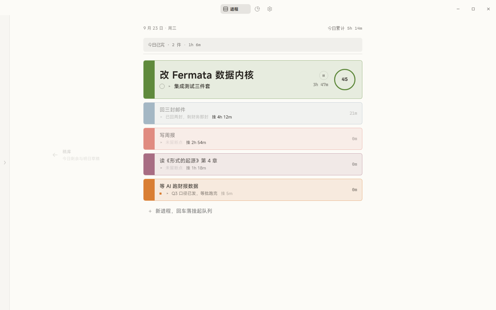 | 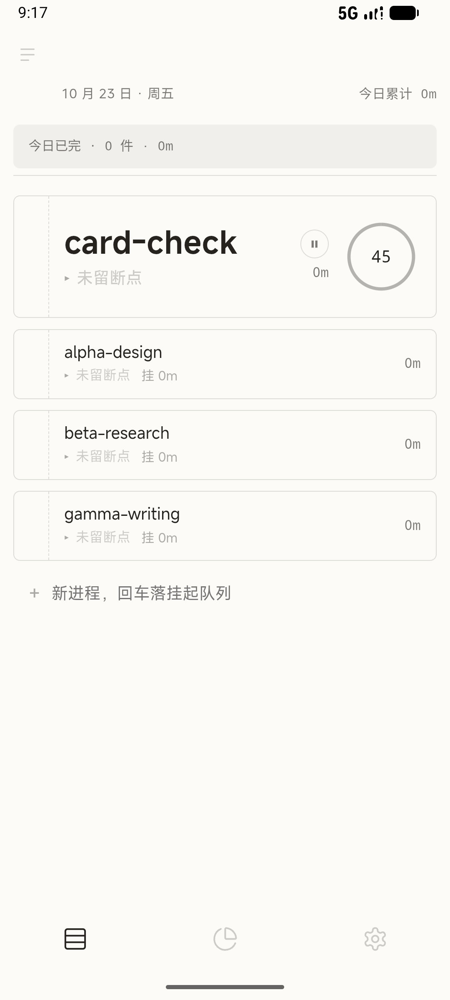 |

普通任务列表记录“该做什么”，Fermata 额外记录“做到哪了”。它为全天与 AI 协作、频繁切换的人而造：内核是一台进程调度器——挂起、恢复、断点、计时、休止符；报纸式排版只是这层调度的呈现。

2.0 起，Windows 与 Android 使用同一套调度语义和数据格式。数据默认留在本机；需要跨设备时，可以接入你自己的坚果云 WebDAV，不经过 Fermata 服务器，无账号、无遥测。

## 一天

早上，从稿库把今天拖进版面；折线上只放一件事，其余的在下面慢慢等着——等得越久的，那一行越淡，“挂”字却越沉。

工作时，`Alt+Q` 一按即换——切走的那件会替你留一句话，下次回来从断点接着做。

离开电脑时，手机上的会话通知继续显示当前进程和计时；暂停、继续都不必回到桌面。对端仍在运行时会有运行锁，想接过来必须显式接管，不会悄悄并行两份计时。

时间片走满，休止符安静地出现，不催、不闹、不自动消失；回不回来，你说了算。

晚上翻统计页，看今天的时间是怎么过去的，顺手把明天写进稿库。偶尔在详情里沉底写两句心得，月底它们自己归成一页。

## 2.0 新变化

- **Android 客户端**：底部纯图标导航、稿库抽屉、详情底卡、长按菜单、触摸拖拽与休止符全链路。
- **跨端同步**：整库快照 gzip、rev 读前检测、整库 LWW；覆盖前双端自动备份，首接冲突由你选择方向。
- **运行锁与接管**：一台设备在跑，另一台看得到；接管时以对端锁时刻收界，避免重叠计时。
- **数据内核升级**：所有实体加入全局 uuid 与 updated_at，删除留墓碑；旧库首启自动迁移。
- **双端适配**：统计三视角、20 分钟粗粒度日网格、触屏友好的设置页与专注式切换确认。

## 特性

| 特性 | 一句话 |
| --- | --- |
| 断点 | 放下前留一句话，回来从原处接着做 |
| 单活跃版面 | 折线上永远只有一件事；跨设备由运行锁约束 |
| 调度即计时 | 切换、休息、空闲、退出自动停表 |
| 休止符 | 到点提醒休息，不催不超时 |
| 三视角统计 | 年 / 月 / 日；桌面 10 分钟一格，手机 20 分钟一格 |
| 可选同步 | 自己的 WebDAV；没有 Fermata 中转服务器 |
| 本地优先 | 默认全在本机；无账号、无云、无遥测 |

## 界面

### Windows

|  |  |
| --- | --- |
| 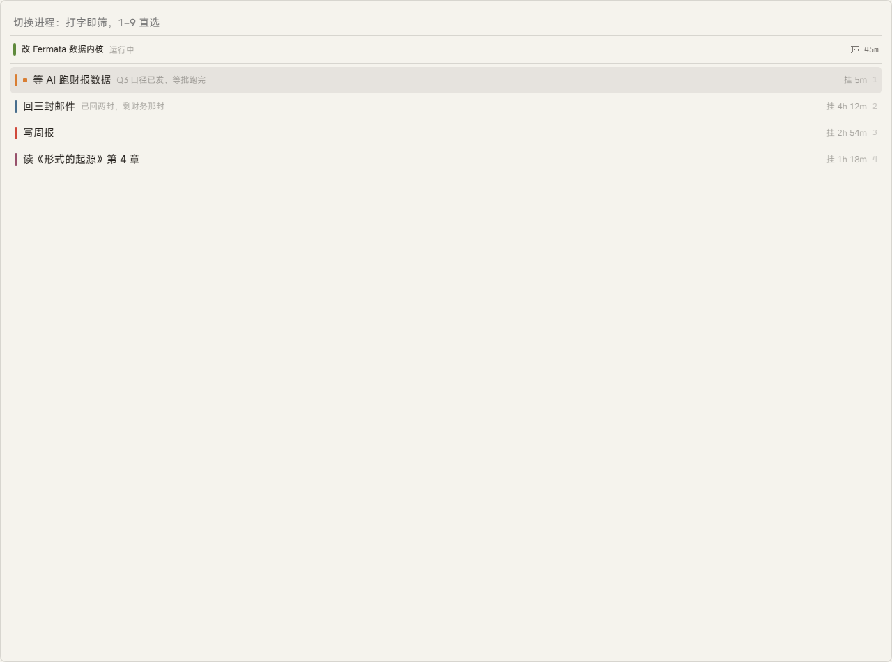 |  |
| **切换浮层**——切走的是任务，留下的是断点 | **休止符**——它不催你，它只是在那里等你 |

|  |  |
| --- | --- |
| 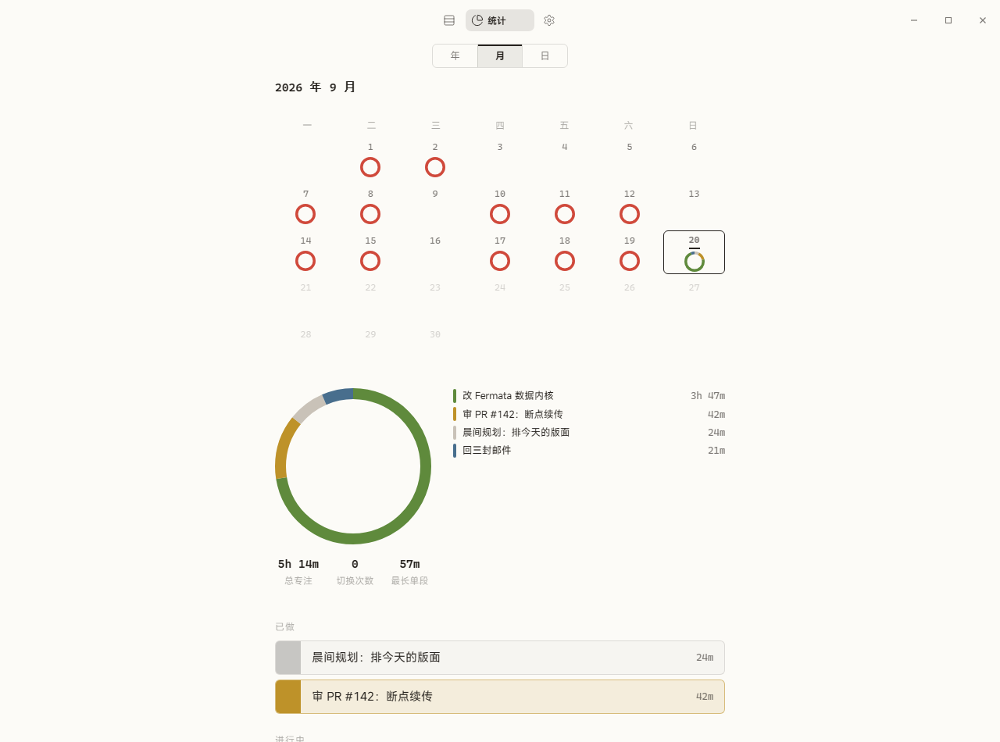 | 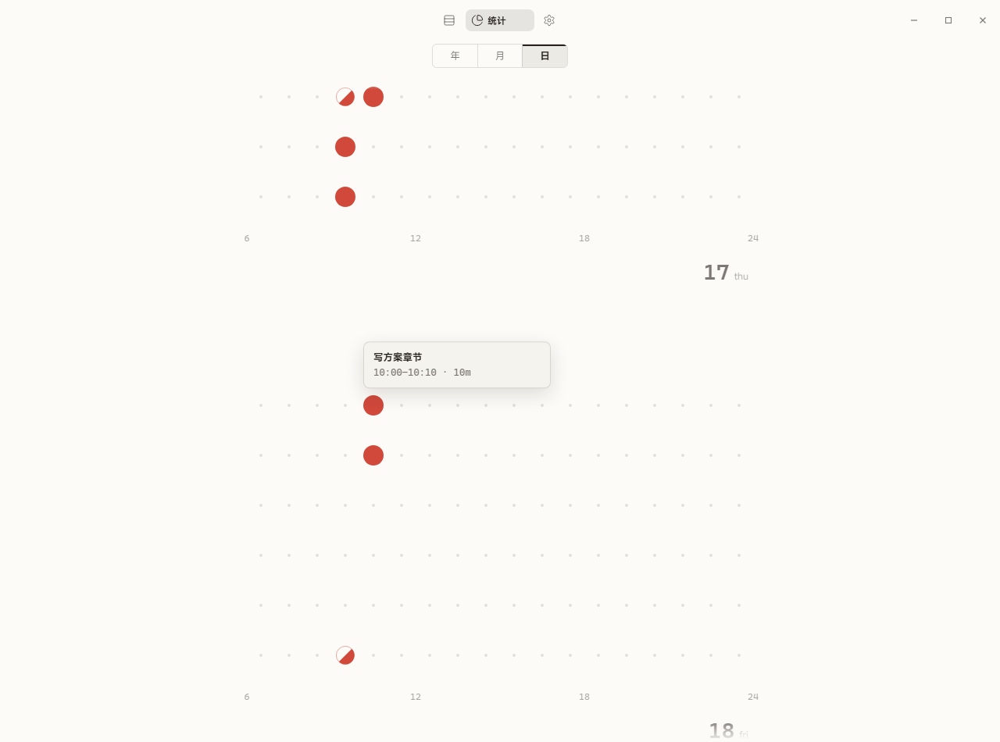 |
| **月**——这个月的每一天，一眼可辨 | **日**——今天的时间是怎么过去的 |

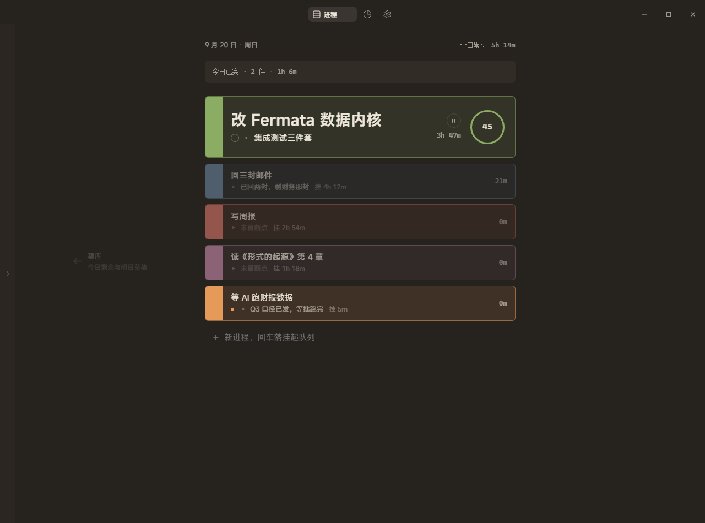

<div align="center"><sub>暗 · 工作台——另一套主题，给夜里干活的人</sub></div>

### Android

|  |  |
| --- | --- |
|  | 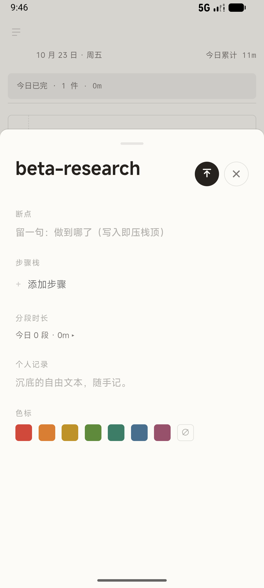 |
| **进程页**——单活跃、断点与挂起队列 | **详情底卡**——断点、步骤栈、记录与色标 |

|  |  |
| --- | --- |
| 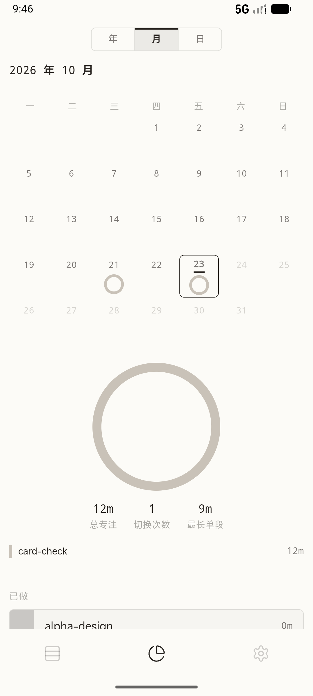 | 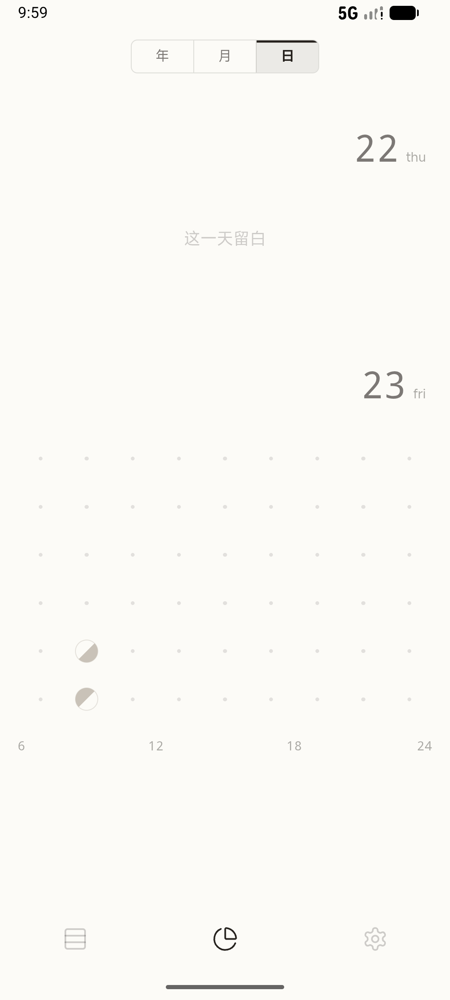 |
| **月统计**——月历、大环与图例在一屏 | **日统计**——20 分钟点阵与占用清单 |

|  |  |
| --- | --- |
| 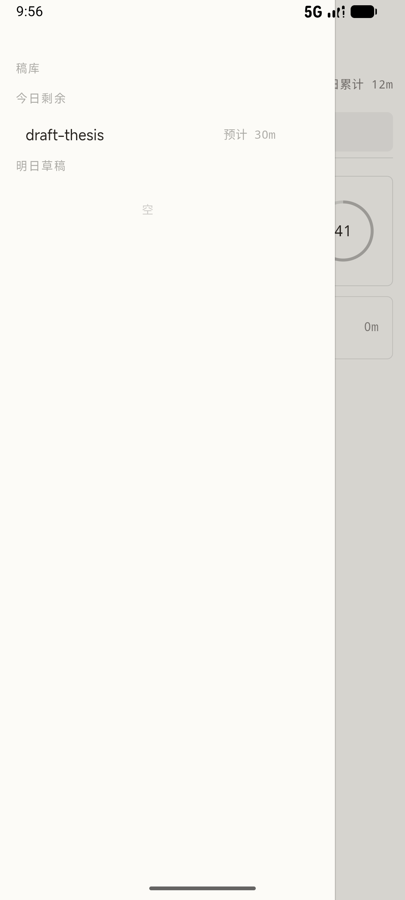 | 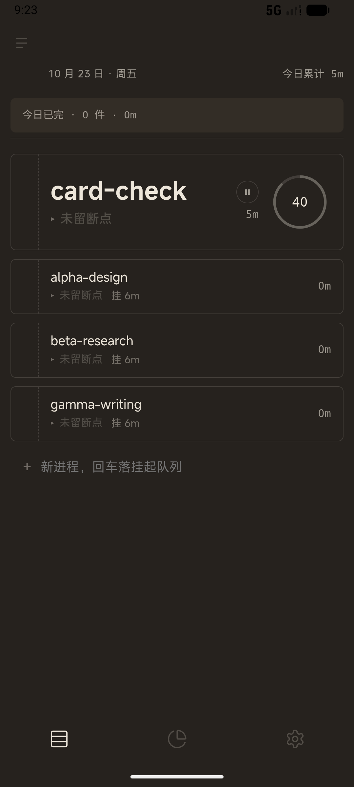 |
| **稿库**——右滑拉出，长按排入或直接开始 | **暗 · 工作台**——同一套材质语言 |

## 安装

| 形态 | 文件 |
| --- | --- |
| Windows 安装包 | `publish/Fermata-2.0.0-setup.exe` |
| Windows 绿色单文件 | `publish/Fermata-2.0.0-portable.exe` |
| Android（arm64） | `publish/Fermata-2.0.0-android-arm64.apk` |

要求 Windows 10/11（WebView2 随系统自带）。首次启动即为空版面，不含任何演示数据。  
从 gika 时代升级：旧数据库首启自动复制迁移，原目录原样保留。2.0.0 会自动执行 v6 数据迁移，升级前建议保留一次备份。

### Android

- APK 为 **arm64-v8a**，要求 Android 7.0+；安装时需要允许未知来源。
- 首次启动请允许通知权限，否则会话通知和到点提醒不可用。
- 同步在「设置 → 同步」中配置：坚果云注册邮箱 + 第三方应用密码；传输走 HTTPS。
- 与桌面端共用同一份 WebDAV 快照。首次接入若两端都已有数据，选择推送或拉取，覆盖方会先自动备份。
- 校验文件：`publish/Fermata-2.0.0-android-arm64.sha256`。

发布说明见 [docs/release-notes/v2.0.0.md](docs/release-notes/v2.0.0.md)。

## 同步

同步是可选的，默认关闭。启用前先准备一个坚果云账号，并在「安全选项 → 第三方应用」生成应用密码。

Fermata 只在你的 WebDAV 目录里保存一份 gzip 快照和运行锁；凭据留在本机（Windows 凭据管理器 / Android Keystore），不写进快照，也不会经过 Fermata 的中转服务。

冲突处理的首版策略是整库后写赢：覆盖前先备份被覆盖的一端；首次接入两端都有数据时，由你选择推送还是拉取。运行锁会显示另一台设备正在做什么，接管是明确动作。

## 开发

Fermata 使用 **Tauri 2 + React + TypeScript + Vite**，数据层为 SQLite；Android 通知/计时桥接由 Kotlin Keeper 插件承担。

```powershell
pnpm install
pnpm dev                 # 前端开发
pnpm tauri dev           # 桌面应用
build-release.bat        # Windows 发布构建
build-android-release.bat # Android arm64 发布构建
```

上手操作与开发者运维见 [docs/manual.md](docs/manual.md)，移动端设计与同步协议见 [docs/07-移动端.md](docs/07-移动端.md)。

Android 发布构建需要本机签名密钥；脚本默认读取 `F:\Fermata-secrets\android-signing`，可用环境变量覆盖。

## 制作

由 **iceforYuri** 设计与开发。  
界面字体 MiSans（小米，免费商用，子集内嵌），许可见 [src/assets/fonts/MiSans-LICENSE.txt](src/assets/fonts/MiSans-LICENSE.txt)。
