<div align="center">

# Fermata

**把一天排成一页版面。**

Windows · Android · 2.0

[安装](#安装) · [界面](#界面) · [跨设备同步](#跨设备同步) · [使用手册](docs/manual.md) · [2.0 发布说明](docs/release-notes/v2.0.0.md)

</div>

Fermata 为频繁切换工作的你，留下每件事的断点。把正在做的工作排成**进程**：当前只做一件，其余挂起；切走前写下“做到哪了”，回来时接着做。计时跟随开始、切换与休息，年、月、日统计保留时间的去向。

2.0 增加 Android 客户端。电脑上整理版面，手机上查看断点、继续进程；需要跨设备时，接入自己的坚果云 WebDAV。数据默认保存在本机，无需 Fermata 账号，也没有 Fermata 中转服务器。

| Windows · 进程页 | Android · 进程页 |
| --- | --- |
| 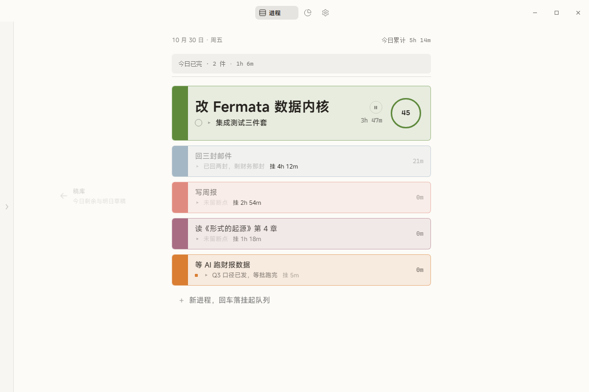 | 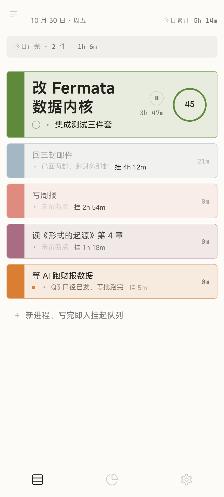 |

## 从放下，到接着做

- **断点与步骤栈**：放下前留一句话，详情里继续整理步骤；个人记录保存过程中的心得。
- **进程与稿库**：准备做的事先留在稿库，排入版面后成为进程；挂起、等 AI、完成各有位置。
- **计时与休止符**：明确开始才计时；进入休息态后停表，继续也由你决定。时间片走满或连续工作达到阈值时提醒休息。
- **年、月、日统计**：从全年概况看到单日时间格；Windows 每格 10 分钟，Android 每格 20 分钟，圆点沿用进程色标。
- **亮与暗**：淡暖纸面和深色工作台，层级靠排版与留白，颜色留给色标。

## 2.0 带来了什么

| | Windows | Android |
| --- | --- | --- |
| 版面 | 稿库左栏、进程中列、详情右栏 | 底部图标导航、稿库抽屉、详情底卡 |
| 操作 | 鼠标拖拽、`Alt+Q` 切换浮层 | 点按查看、长按菜单、横滑切换 |
| 计时 | 桌面时间环、休止符与空闲检测 | 会话通知、通知栏暂停/继续、到点提醒 |
| 统计 | 年 / 月 / 日，悬停查看时间格 | 年 / 月 / 日，点按查看时间格 |
| 数据 | 本地 SQLite；可选 WebDAV 同步 | 本地 SQLite；可选 WebDAV 同步 |

两端共用进程、断点与计时规则，操作布局分别适配鼠标和触屏。Android 首版提供 arm64 APK，通过安装包分发。

## 界面

以下为 2.0 当前组件的浏览器预览，使用中文演示数据；不包含个人数据，也不代表真机通知、后台行为已验收。[截图来源与复现方式](docs/screenshots/release/v2/README.md)。

### Windows

| 详情与步骤栈 | 月统计 |
| --- | --- |
| 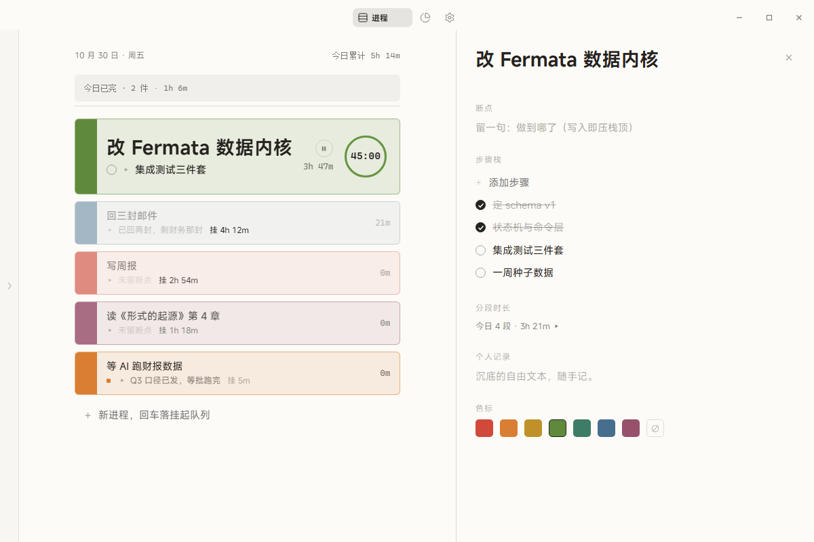 | 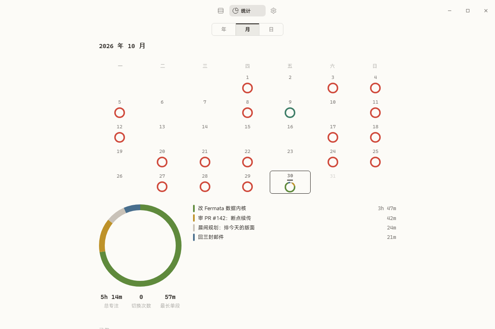 |

| 日统计 | 同步设置 |
| --- | --- |
| 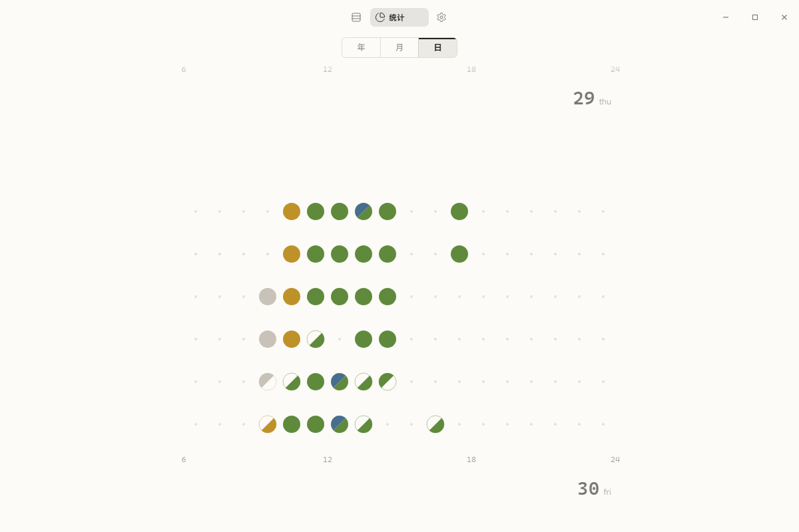 | 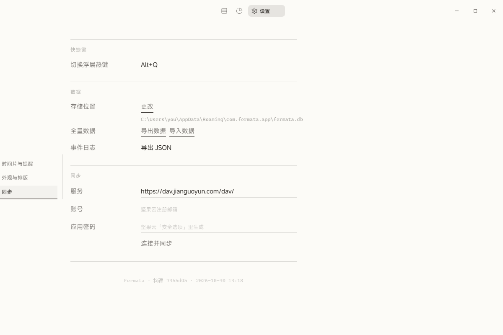 |

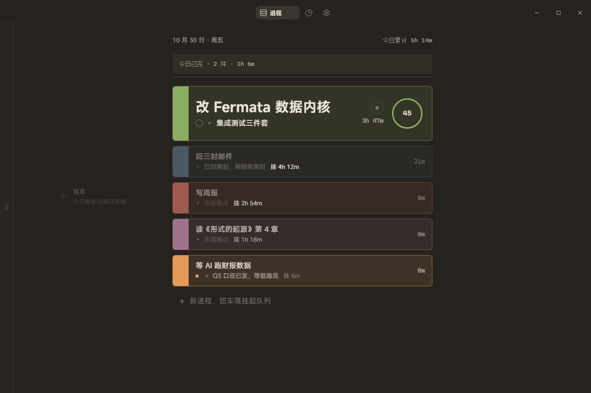

### Android

| 详情底卡 | 稿库抽屉 |
| --- | --- |
| 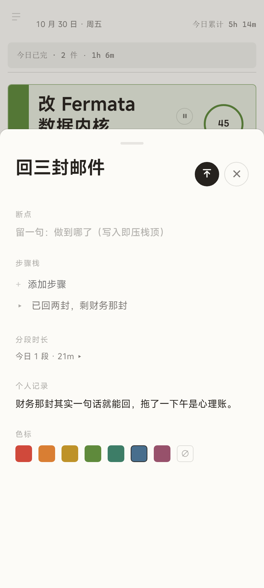 | 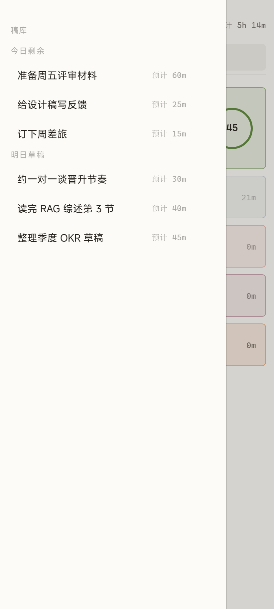 |

| 月统计 | 日统计 |
| --- | --- |
| 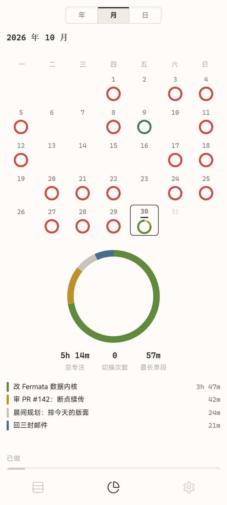 | 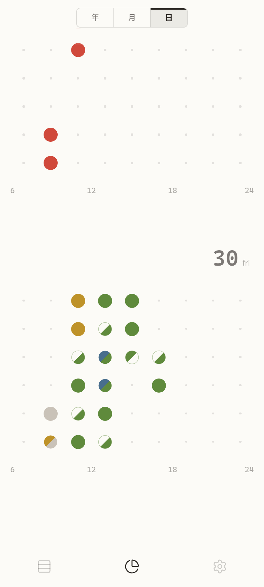 |

| 同步设置 | 暗色工作台 |
| --- | --- |
| 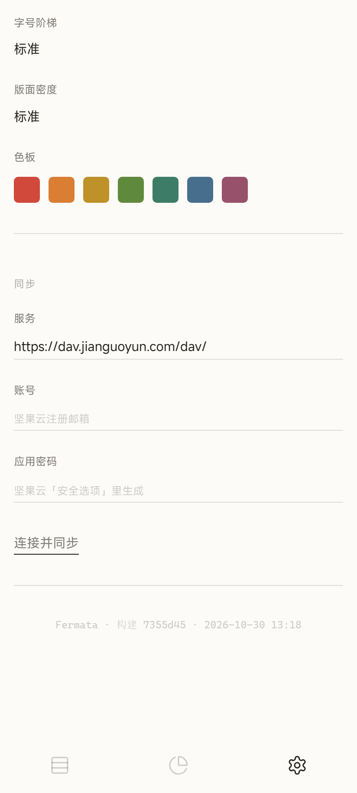 | 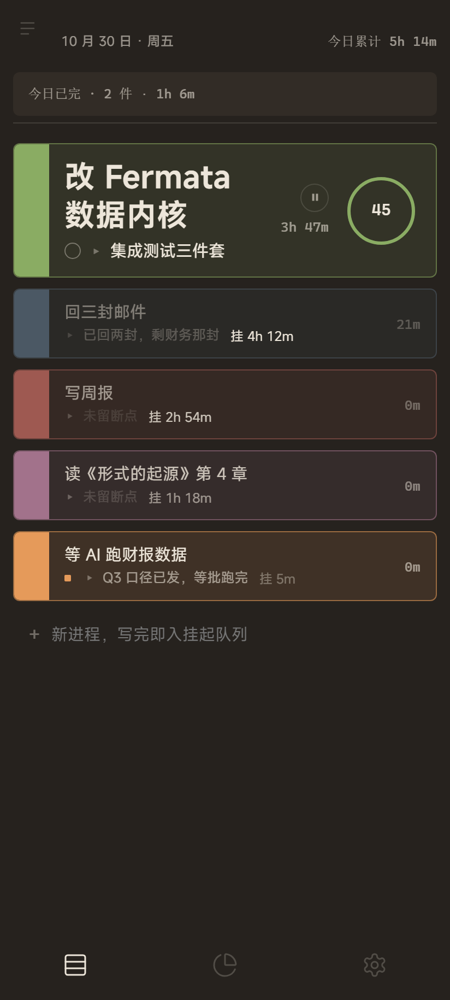 |

## 安装

2.0.0 目前处于发布验收阶段，正式发布后可在 [GitHub Releases](https://github.com/iceforYuri/Fermata/releases) 下载。本地发布产物统一放在 `publish/`，该目录不纳入 Git。

| 平台 | 安装包 | 要求 |
| --- | --- | --- |
| Windows 安装版 | `Fermata-2.0.0-setup.exe` | Windows 10/11，需 WebView2 运行时 |
| Windows 绿色版 | `Fermata-2.0.0-portable.exe` | 同上 |
| Android | `Fermata-2.0.0-android-arm64.apk` | Android 7.0+，arm64-v8a |

首次启动为空版面，不包含截图中的演示数据。Android 安装时允许安装来源；Android 13 及以上还需允许通知权限，才能显示会话通知和到点提醒。

从旧版升级时，首次启动自动执行数据迁移，保留进程、计划与计时记录。升级前可在 Windows「设置 → 数据」导出一份快照。2.0 的数据结构有变化，需要回退旧版时应使用升级前的备份。

校验文件随安装包提供：`Fermata-2.0.0-windows.sha256`、`Fermata-2.0.0-android-arm64.sha256`。

## 跨设备同步

同步可选，默认关闭。在两台设备的「设置 → 同步」中填写同一份坚果云 WebDAV 地址、注册邮箱和第三方应用密码，然后连接。密码由坚果云的「安全选项 → 第三方应用」生成。

同步传输压缩后的整库快照；没有变化时检查版本，不重复上传。凭据保存在本机的 Windows 凭据管理器或 Android Keystore，不进入同步快照。外观、快捷键和同步配置留在各设备，计时参数随数据同步。

**首版不会逐条合并两端修改。** 首次连接时，如果本机和远端都有数据，由你选择推送还是拉取；已有同步基线后，两端都修改时采用远端版本，本机修改先自动备份。强制推送覆盖远端时，也会先备份远端快照。具体恢复方法见[手册](docs/manual.md#跨设备同步与恢复)。

运行锁会提示同一进程正在另一台设备上运行，并提供显式接管。它依赖网络和同步状态；离线时无法即时获知对端操作。更换设备前先完成同步，避免两端离线修改同一份数据。

## 开发

**Tauri 2 + React + TypeScript + Vite + SQLite**。两端复用 Rust 数据内核和前端业务逻辑；Android 原生通知与计时桥接由 Kotlin Keeper 插件提供。不引入 UI 组件库。

```powershell
pnpm install
pnpm dev                          # 浏览器预览（演示数据）
pnpm tauri dev                    # Windows 应用（本地数据库）
.\build-release.bat               # Windows 发布构建
.\build-android-release.bat       # Android arm64 发布构建
```

Android 构建还需 JDK、Android SDK/NDK、Rust Android target 与本机签名密钥，环境记录见 [移动端 PoC 日志](docs/mobile-poc-log.md)。签名密钥用于后续覆盖升级，不能随安装包分发或提交到仓库。

[使用手册](docs/manual.md) · [移动端设计与同步协议](docs/07-移动端.md) · [2.0 发布说明与验证范围](docs/release-notes/v2.0.0.md)

## 制作

由 **iceforYuri** 设计与开发。界面字体 MiSans，许可见 [MiSans-LICENSE.txt](src/assets/fonts/MiSans-LICENSE.txt)。
