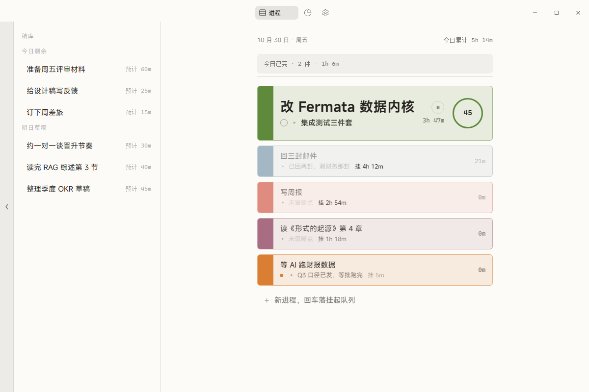
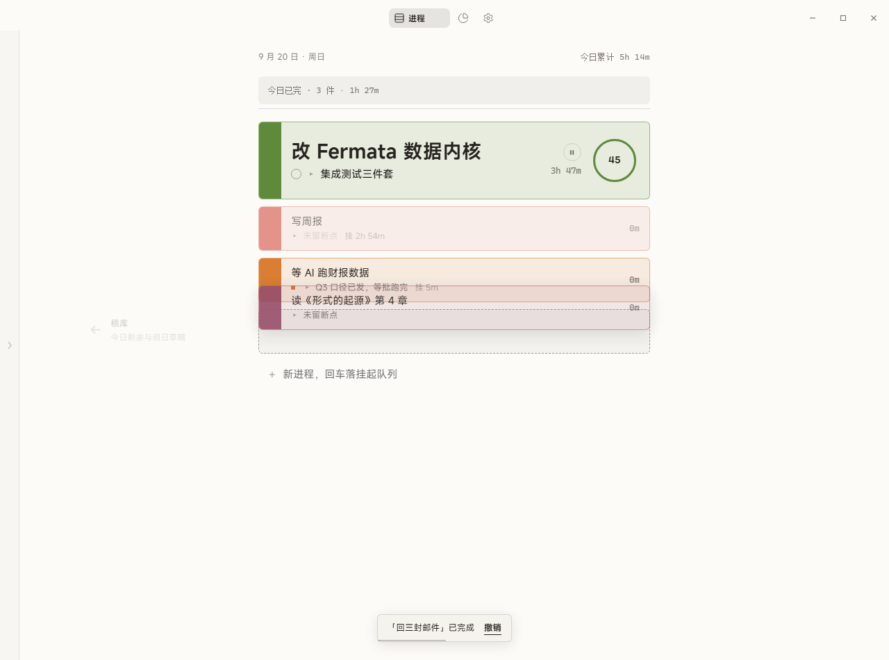
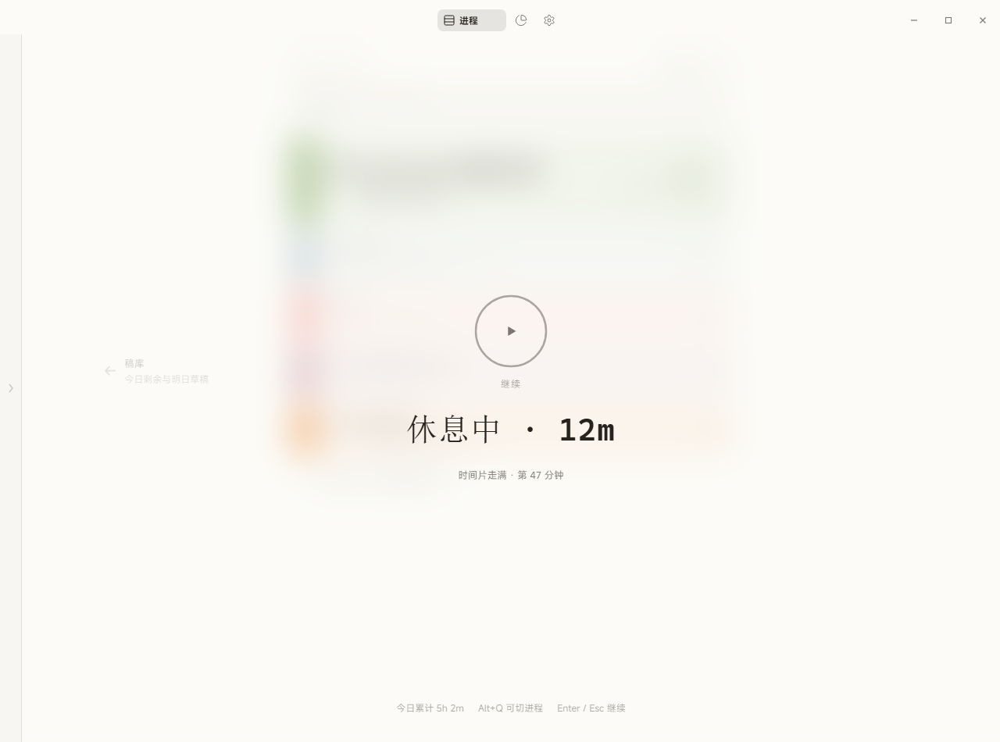
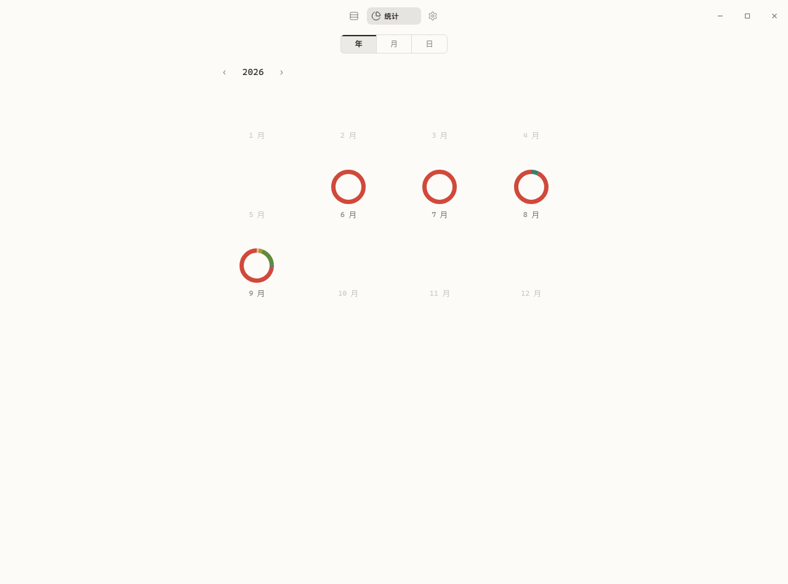
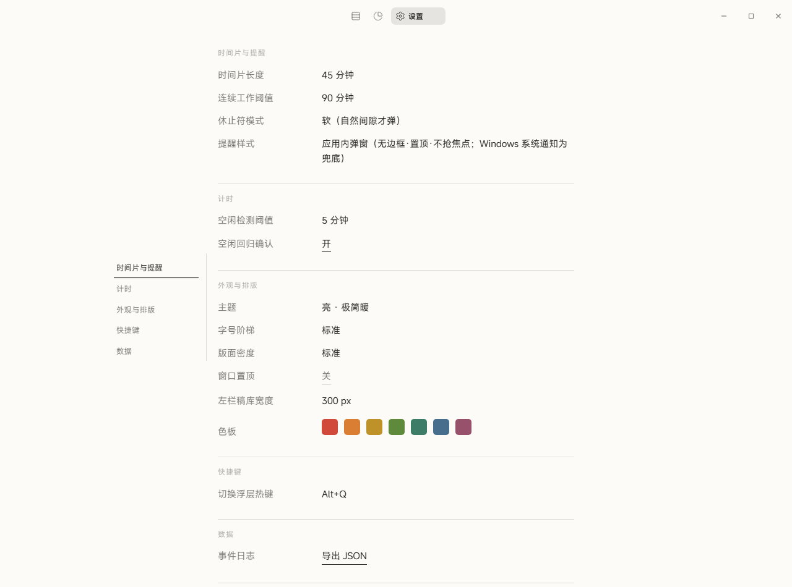

# Fermata 使用手册

> 适用于 Fermata 2.0 的 Windows 与 Android 客户端。产品介绍和安装包说明见 [README.md](../README.md)，新截图来源见 [2.0 界面预览](screenshots/release/v2/README.md)。下文 Windows 浮层等未更新的图片保留在原截图目录。

## 上手

### Android：先熟悉四个入口


- **底部导航**：从左到右为进程、统计、设置。点图标切换，也可横滑；每次进入统计先显示月视角。
- **稿库**：在进程页向右滑，或点左上角稿库图标展开；抽屉向左滑关闭。长按计划，选择「排入今天」或「直接开始」。
- **进程详情**：点按进程主体，底卡从下方展开。标题、断点、步骤栈和个人记录可原地编辑；编辑按确认或失焦落盘，不需要额外保存。挂起进程卡顶部的上箭头用于列为当前在做；有旧进程运行时，先确认旧进程断点。关闭按钮、点卡外空白，或内容在顶部时下拉，均可收起卡片；向上滑查看下方内容。
- **进程操作**：长按挂起行展开菜单，可完成、查看详情或上移/下移。长按后拖动可重排；遇到设备触摸差异时，用菜单上移/下移。

手机统计的横滑按顺序经过「年 → 月 → 日」，反向滑动可返回。年视角继续右滑进入进程页，日视角继续左滑进入设置页；也可以直接点顶部年/月/日。日视角上下滚动浏览日期，**点时间格**查看该格的进程和占用时长，每格为 20 分钟。

会话通知显示当前进程，并提供暂停/继续。Android 13 及以上需要允许通知权限。正常息屏和切后台依靠时间戳记账；后台提醒与系统回收后的表现仍需按设备验收，不能通过浏览器截图验证。

### Windows：进程页（Tab 1 · 版面）


- 一天的事情排成一页：**折线**上方是已完，折线上是唯一在做的**运行**进程，下方是**挂起**队列
- **开始**：点挂起行（或把它拖过折线）→ 断点卡从旧进程行下方展开、**右侧详情栏同步展开钉在该进程**；留一句话（可空）回车即切换，详情栏不跳——改步骤、改断点不用先置顶
- **完成**：点行首色脊确认条，3 秒内可撤销；超时入**完成档案**（点顶部已完栏可查、可重新打开）
- **老化**：挂得越久，卡片与小字越淡（线性、4h 触底 0.45），**「挂 xx」小字越沉**（4h 到顶浓墨）——行退后，时间债靠前；hover 行复活，标签不动。时长 = 距上一次挂上，捞回清零重计
- **步骤栈**：详情栏里新步骤置顶；写断点 = 往栈顶压一条断点条；当前步骤槽永远显示栈顶——"接着做哪"不用想
- **时间环**：活跃行右端，时间片倒计时；点环可临时改本次片长（25/45/90/自定义）；最后 5 分钟环会呼吸
- **等 AI**：挂起的子状态，不褪色、标签不加深、切换浮层里排前；在详情栏或切换浮层按 `A` 标记

详情栏（点进程唤出，右栏推拉）：


稿库（左缘细栏点开，拖入中列即成进程）与拖拽重排（弹性补位 + 落点虚影）：




### Windows：切换浮层（Alt+Q）


进程版 Alt+Tab：打字即筛、无匹配即"新建并切换"、数字键 1–9 直选、`A` 标等 AI、Enter 切换（随后可留断点，再 Enter 走人）、Esc 收起。

### Windows：休止符


时间片走满或连续工作 90 分钟触发。三选：暂不休息 / 休息 / 翻下一篇；✕ = 进入休息。休息无固定时长、无自动结束。休息态下主窗 Tab 1 是玻璃休息页（灰满环 + ▶ 继续，`Enter`/`Esc` 等价）：



### Windows：统计页（Tab 2）


- 视角胶囊 **年 / 月 / 日**；年点月环进月、月双击日期进日、日视角纵向滚动（上滚历史、下界今天）
- 月历每格迷你日环（按色标聚合）；大环每进程一片；当天视图：已做 / **进行中**（今天）或**未做完**（非今天）/ 未做（计划）/ 挂起成本
- **色脊点一下 = 补登完成**（历史天的未做完顺手清账，3 秒撤销）；**点行 = 进程详情卡**（玻璃子页：断点 / 步骤栈 / 当日分段 / 个人记录 / 色标）
- 详情卡里**回归** = 把进程变成今天（或任选一天）稿库里的同名计划——源进程原地封存，历史不改写；计划拖上版即成新进程
- 日网格 18×6 = 06–24 时、每格 10 分钟；不满格画 45° 斜半圆；悬停圆点看进程与区间内时长：


**个人记录**（当天视图下方入口"个人记录 · 本月 N 条 →"）：全部进程的心得按月归成一页——色标点当项目符号，每条带"记于"时刻；写记录自动落时间戳；点行开该进程详情卡。顶部"月度汇总"位留给后续的 LLM 接入：


年视角（12 月环，只显示有记录的年份范围）：



### Windows：设置页（Tab 3）



左侧分组导航：时间片与提醒 / 计时 / 外观与排版 / 快捷键 / 数据。全部双态控件——点文字原地变形，Enter 或失焦提交，Esc 还原。可改全局热键（默认 Alt+Q）、主题（亮 · 淡暖 / 暗 · 工作台）、置顶等。

数据组：全量快照**导出 / 导入**（导入前自动备份当前库，确认覆盖层为玻璃卡）、事件日志导出 JSON、**存储位置**可指定（热切换，超 400ms 有玻璃交代层；原库备份式迁移）。

## 跨设备同步与恢复

两端均在「设置 → 同步」连接同一个坚果云 WebDAV 目录，使用注册邮箱与第三方应用密码。密码保存在本机系统安全存储中，不进入同步快照。应用启动、回到前台和数据变动会触发同步流程；可以通过「立即同步」主动检查结果，操作后以设置区的结果提示为准。

同步传输整库 gzip 快照，通过远端版本号决定推送或拉取，不会逐条合并进程或步骤：

| 情形 | 当前行为 |
| --- | --- |
| 远端没有快照 | 上传本机快照 |
| 首次连接，两端都有数据 | 询问推送还是拉取；覆盖前备份被覆盖的数据 |
| 本机修改，远端仍是上次同步版本 | 推送本机数据，更新远端版本 |
| 远端已有新版本 | 拉取远端；若本机也有修改，先备份本机，再覆盖并提示 |
| 手动强制推送 | 先备份远端当前快照，再上传本机数据 |

本机冲突备份在应用数据目录的 `exports/backup-*.fermata.json`，远端强制覆盖备份在 WebDAV 的 `fermata/backups/`。需要恢复时先停止两端修改，保留现有数据和备份；Windows 可在「设置 → 数据 → 导入」选择本机快照。远端 `.json.gz` 备份需先解压，再导入其中的 JSON 快照。Android 首版没有桌面文件导入入口，可先在 Windows 恢复，再同步到手机。

运行锁按进程标识提示另一台设备正在运行，过期锁显示「可能仍在运行」。接管是明确操作，不能依靠离线锁保证两端互斥；更换设备前先同步，接管后再确认新设备的计时。

## 运维（开发者）

```bash
pnpm install
./run-dev.bat           # 纯预览：完整构建后拉起内嵌 exe（无热重载，改完重跑）
pnpm tauri dev          # 开发态（热重载；桌面窗口吃内嵌 dist 的已知问题见 docs/deviation.md D53）
pnpm tauri build        # 产物在 src-tauri/target/release/，拷贝到 publish/ 即发布位
```

- 演示数据：`pnpm seed` / `pnpm seed:deep`；`FERMATA_DB_PATH` 指定库文件
- 数据库：默认 `%APPDATA%/com.fermata.app/fermata.db`（设置页可改目录，指针文件记忆）；local-first SQLite，事件日志 append-only（个人记录的每次写入带全文留痕）
- 内核验证：在 `src-tauri/` 运行 `cargo test`；前端类型检查：`pnpm exec tsc --noEmit`。2.0 截图：先启动 `pnpm dev`，再运行 `node scripts/shot-v2-release.mjs`。历史桌面验收总表位于 `docs/screenshots/release/checklist.md`，2.0 验收范围见[发布说明](release-notes/v2.0.0.md)。
- 结构：`src/`（api 薄封装 · pages · store · styles/tokens）｜`src-tauri/`（db 内核 · commands · sys 六原语）｜`docs/`（设计合同 01–04 · ADR · 证据）
- 分支：`dev` 开发主线 / `main` 发布 / `feature/*` 功能分支
- 词汇与纪律：[CONTEXT.md](../CONTEXT.md)、[AGENTS.md](../AGENTS.md)
